 
<!--
HASSAN AWAN — GitHub Profile README
Theme: Navy / Steel Blue / Cyan / Gold
-->

<!-- ANIMATED BANNER -->

 

Final-Year Information Technology Student at <b>Bahria University</b>, Karachi, Pakistan.
 
Building meaningful digital experiences through clean code, creative problem-solving, and continuous learning.

 

<!-- SOCIAL LINKS -->

&nbsp;

&nbsp;

  

📍 Karachi, Pakistan &nbsp; | &nbsp; 🎓 Bahria University &nbsp; | &nbsp; 💻 Software Development

  

  

 

## 01 The Developer

Hi! I'm **Hassan**, a final-year BSIT student who loves building useful software, modern web applications and data-driven solutions.

I enjoy mixing engineering with creativity, from full-stack web development to Python analytics and real-time 3D graphics.

- 🎓 **Education:** BSIT, final year
- 💻 **Focus:** MERN stack and full-stack web development
- 🧠 **Exploring:** Artificial Intelligence, Machine Learning, data analytics
- 🌌 **Creative computing:** C++, OpenGL and 3D environments
- 🌱 **Mindset:** Learn by building, experiment, improve, repeat
- 🤝 **Open to:** Collaboration, internships and meaningful projects

 

  

## 02 Technology Matrix

**Languages**

**Frontend**

**Backend**

**Databases & Tools**

 

  

## 03 Selected Projects

*Four different challenges. Four different areas of development.*

### 🌌 Aetheria: The Floating Sanctuary

A procedural 3D world built with **C++ and OpenGL**: a floating sanctuary with terrain, mountains, wildlife, a cabin, animated clouds, water effects, lighting and interactive camera controls.

- Primitive-based 3D modelling and scene transformations
- Lighting, depth testing, blending, fog and perspective projection
- Timer-driven environmental animation and keyboard navigation

`C++` `OpenGL` `GLU` `GLUT/freeglut`

 

### 🌾 Pakistan Agri-Market Price Predictor & Advisor

A **Streamlit** academic prototype that explores historical crop producer prices in Pakistan, with interactive visualizations and rule-based agricultural guidance.

- Historical price analysis using Pandas and NumPy
- Experimental Linear Regression and Decision Tree forecasting
- Plotly charts and a keyword-based English / Roman Urdu advisory interface

`Python` `Streamlit` `Pandas` `scikit-learn` `Plotly`

 

### 🛒 Use & Return: Online Rental Marketplace

A full-stack prototype for product rentals: browse products, search the catalogue, manage a cart and calculate pricing by rental duration.

- Reusable React components and client-side navigation
- Product filtering and cart quantity management
- Express API foundation with MongoDB and Mongoose

`React` `Vite` `Node.js` `Express.js` `MongoDB`

 

### 🛡️ PhishGuard: ML-Based Phishing URL Detection

A Python web app that classifies URLs as safe or phishing using machine learning models trained on public phishing datasets.

- Compares Logistic Regression, Decision Tree and Random Forest models
- Trained and evaluated on public phishing URL datasets
- Simple web interface for checking a URL

`Python` `scikit-learn` `Machine Learning` `Cybersecurity`

 

## 04 GitHub Telemetry

  

  

<!-- CONTRIBUTION SNAKE -->
<picture>
<source media="(prefers-color-scheme: dark)" srcset="https://raw.githubusercontent.com/hassan1450/hassan1450/snake-output/github-snake-dark.svg"/>
<source media="(prefers-color-scheme: light)" srcset="https://raw.githubusercontent.com/hassan1450/hassan1450/snake-output/github-snake.svg"/>

</picture>

  

## 05 Connect To My Network

I'm always happy to connect with developers, share knowledge and grow through practical projects.

  

&nbsp;

&nbsp;

  

📧 **nuhf1890@gmail.com**

  

  

**END OF TRANSMISSION // KEEP BUILDING.**

Designed by Hassan · Learning through code, one project at a time.

